# 🗼 Vértice Control Tower · Enterprise PMO Lakehouse & AI Analytics

[](https://www.databricks.com/)
[](https://www.databricks.com/product/unity-catalog)
[](https://delta.io/)
[](https://www.databricks.com/)
[](https://mlflow.org/)
[](https://www.python.org/)
[](LICENSE)

> **Plataforma de Dados e IA ponta a ponta construída no Databricks** para unificação de cronogramas multi-ferramenta (Excel, ClickUp e MS Project), governança de indicadores de Valor Agregado (EVM), auditoria de contratos com IA Generativa e predição de estouro de prazo/custo com Machine Learning.

---

## 📌 Visão Executiva e Problema de Negócio

A **Vértice Tecnologia** gerencia um portfólio de **60 projetos corporativos** (totalizando **R$ 305,2 milhões** em contratos nos setores de varejo, financeiro, saúde, logística e indústria) com **520 profissionais** alocados.

Antes da **Torre de Controle**, a diretoria enfrentava quatro desafios críticos de visibilidade:
1. **Fragmentação Operacional:** Cada gerente controlava seu cronograma em uma ferramenta distinta (**20 projetos em planilhas Excel, 25 no ClickUp via JSON e 15 no MS Project via XML**), com formatos incompatíveis de datas, fases e percentuais.
2. **Assimetria de Status ("Projetos Melancia"):** Nos reportes executivos semanais, os gerentes classificavam seus projetos com farol **Verde**, ocultando atrasos reais severos no cronograma físico.
3. **Alocação Ineficiente de Especialistas:** Engenheiros de confiabilidade (SREs) permaneciam subutilizados em projetos em fase inicial (*discovery*), enquanto implantações críticas atrasavam por falta de suporte em infraestrutura.
4. **Risco Financeiro e Contratual Reativo:** Expansão de escopo sem aditivo (*scope creep*) e atrasos de consultorias terceirizadas geravam erosão de margem sem acionamento tempestivo de cláusulas de multa contratual.

### 🎯 Perguntas Estratégicas Respondidas pela Plataforma

| # | Questão Executiva | Indicadores e Modelos na Plataforma |
|---|---|---|
| **1** | **Quais projetos estão atrasados e de quais clientes?** | Cálculo unificado de **SPI** (*Schedule Performance Index*), **CPI** (*Cost Performance Index*) e cruzamento *Farol Reportado × Farol Calculado* |
| **2** | **Qual o impacto financeiro estimado dos atrasos?** | Projeção de **EAC** (*Estimate at Completion*), **Estouro Previsto (R$ 6,47 mi)**, **Margem Projetada** e atraso em dias |
| **3** | **Há especialistas ociosos enquanto outros projetos estão bloqueados?** | Cruzamento de *Timesheet* (taxa de ocupação e custo de ociosidade) com causas de bloqueio extraídas via **IA Generativa** (`ai_extract`) dos relatórios de status |
| **4** | **Quais projetos vão estourar nos próximos 30 dias?** | Modelo preditivo **HistGradientBoosting** registrado no Unity Catalog (**AUC 0,92**, 41 dias de antecedência média) + auditoria de contratos em PDF via `ai_parse_document` |

---

## 🏛️ Arquitetura da Solução (Databricks Lakehouse)

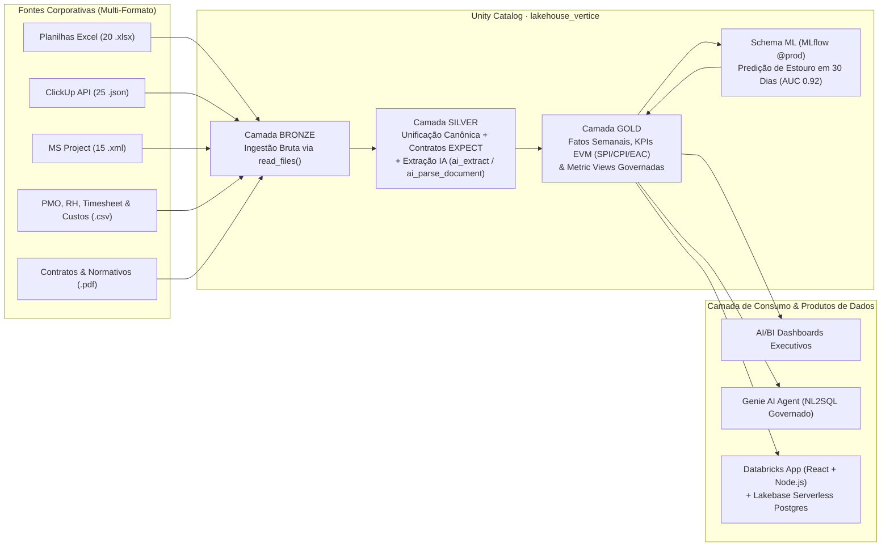

### Pilares Técnicos Implementados
* **Ingestão Multi-Formato Sem Conversão Prévia (`Bronze`):** Uso de `read_files()` lendo diretamente arquivos `.xlsx` (Excel), `.json` aninhados (ClickUp), `.xml` MSPDI (MS Project), `.csv` e `.pdf` armazenados em Unity Catalog Volumes.
* **Pipelines Declarativos e Data Quality (`Silver`):** Lakeflow Declarative Pipelines unificando as três ferramentas de gestão em uma tabela canônica (`silver.tarefas`), tratando números de série do Excel, timestamps em milissegundos, tarefas-resumo do MS Project, linhas de subtotal e variações de grafia, com contratos `EXPECT (... ON VIOLATION FAIL UPDATE)`.
* **Modelagem Dimensional e Metric Views (`Gold`):** Fatos históricos semanais (`fato_projeto_semana`), fotografia executiva (`projeto_situacao_atual`), matriz de ocupação (`utilizacao_pessoa_semana`) e **Metric Views** governadas no Unity Catalog (`mv_projetos`).
* **IA Generativa Aplicada a Dados Não Estruturados:**
  * Extração de causas de atraso e bloqueios a partir de textos livres de status semanal utilizando `ai_extract()` e `ai_classify()`.
  * Parsing estruturado de contratos de fornecedores em PDF via `ai_parse_document()` para cálculo automático de multas por descumprimento de SLA.
* **Machine Learning Preventivo (`ML`):** Engenharia de features temporais sem vazamento de dados (*data leakage*), treinamento com validação em janela móvel (MLflow + Unity Catalog Registry) e inferência em lote (`gold.score_estouro_30d`).
* **Aplicação Operacional (`Databricks Apps + Lakebase`):** Aplicação Full-Stack (React + TypeScript + Node.js) integrada ao **Lakebase (PostgreSQL Serverless)** para simulação de realocação de especialistas e registro auditável de decisões executivas.

---

## 📊 Principais Resultados e Indicadores do Caso

| Indicador Auditado na Plataforma | Resultado Identificado |
|---|---|
| **Portfólio Total / Em Andamento** | **60 projetos** (R$ 305,2 mi) · **41 em andamento** (R$ 208,6 mi) |
| **Projetos em Risco (SPI ou CPI < 0,90)** | **17 projetos** (sendo **7 críticos** com índice < 0,80 distribuídos nas 3 ferramentas) |
| **Estouro Orçamentário Projetado (EAC − Orçamento)** | **R$ 6,47 milhões** na carteira ativa |
| **Projetos "Melancia" (Farol Verde × SPI < 0,90)** | **4 projetos** (`PRJ-012`, `PRJ-028`, `PRJ-034`, `PRJ-042`) identificados automaticamente |
| **Otimização de Alocação (SRE)** | **2 SREs seniores com ~5% de ocupação** no `PRJ-007` realocáveis para destravar o `PRJ-011` |
| **Performance do Modelo Preditivo (30 dias)** | **AUC 0,92** (detecção de **9 em 10 estouros** com antecedência média de **41 dias**) |
| **Recuperação Contratual (Fornecedores)** | **R$ 1,12 milhão** em multas contratuais apuradas sobre atrasos de entregas da consultoria *CodeForge* |

---

## 🖥️ Demonstração Visual da Plataforma

### 1. Da Ingestão Bruta (Bronze) ao Modelo Unificado (Silver & Gold)

| Planilhas Excel com Subtotais e Datas Mistas | Exports JSON Aninhados (ClickUp) | Cronogramas XML MSPDI (MS Project) |
|---|---|---|
| 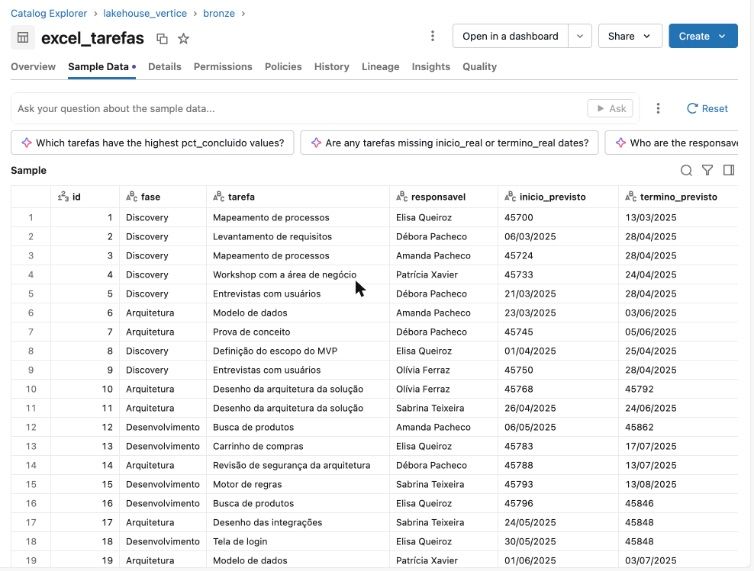 | 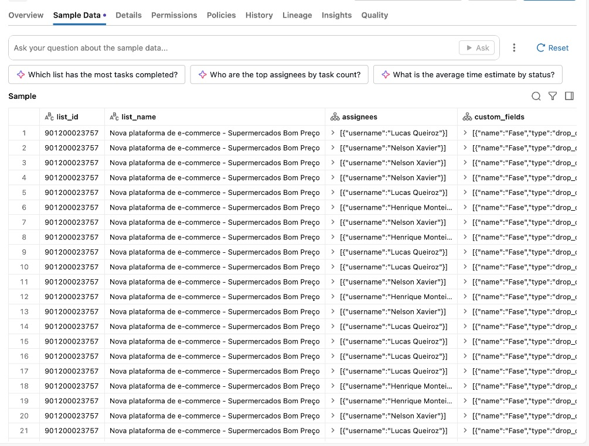 | 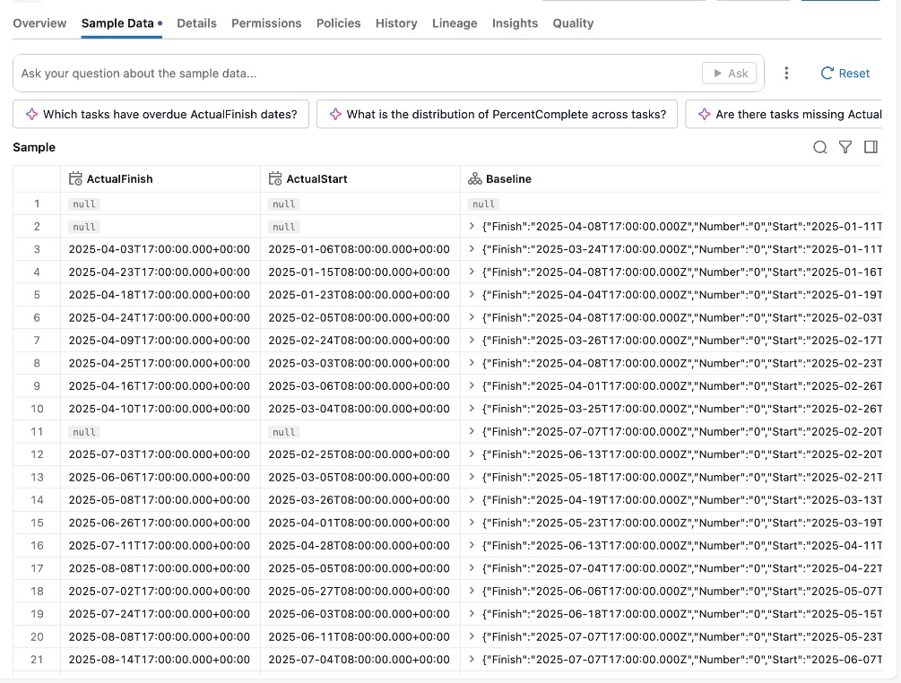 |

| Modelo Canônico Unificado (`silver.tarefas`) | Camada Analítica Governada (`gold`) |
|---|---|
| 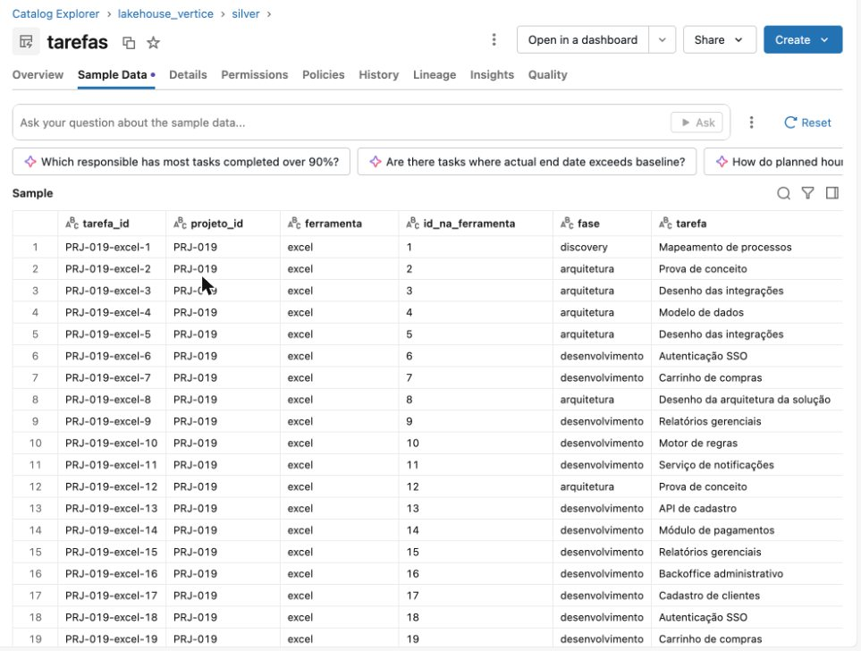 | 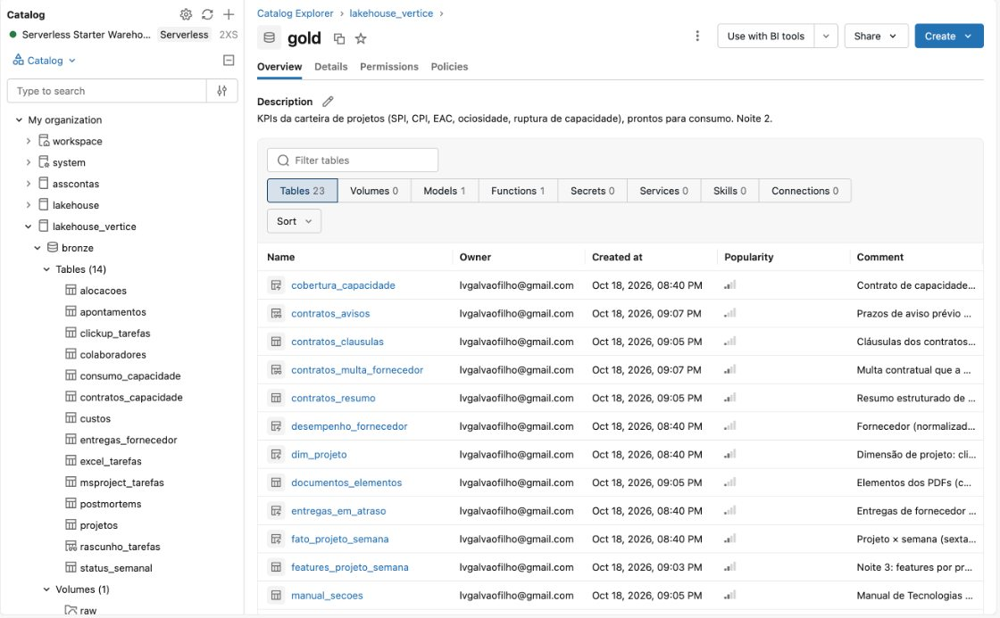 |

### 2. Orquestração, Dashboards Executivos, Machine Learning e App

| Pipeline Declarativo Lakeflow (Silver & Gold) | Orquestração Completa em Databricks Workflows |
|---|---|
| 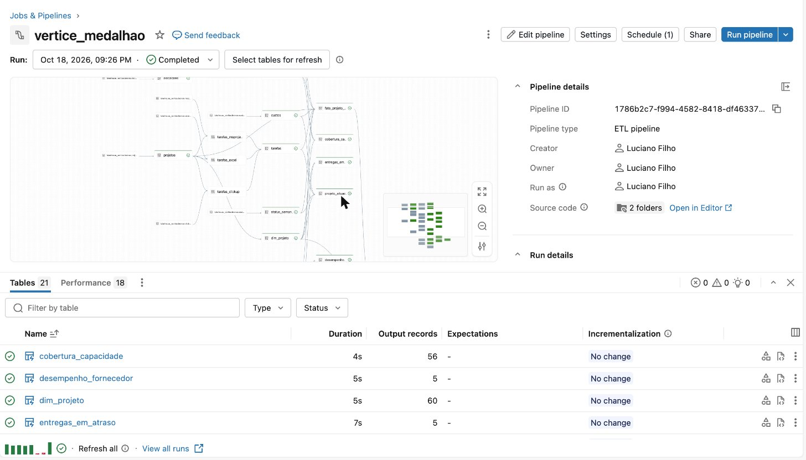 | 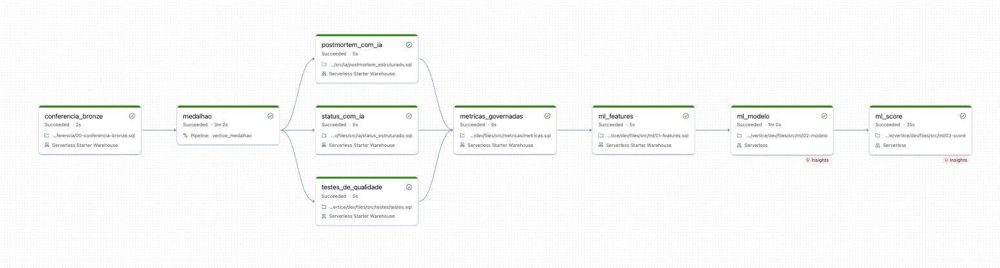 |
| **Dashboard Executivo de Portfólio (AI/BI)** | **Predição de Estouro em 30 Dias (MLflow & UC)** |
| 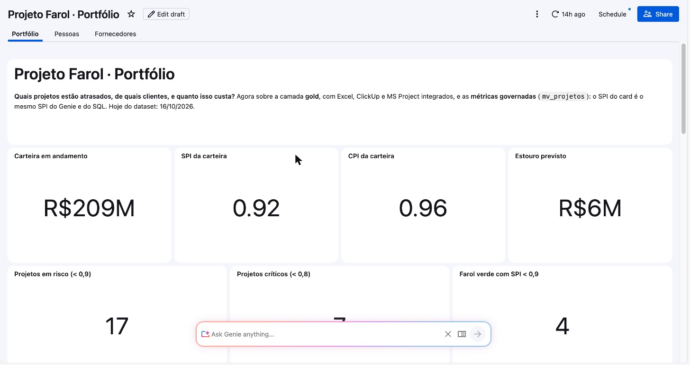 | 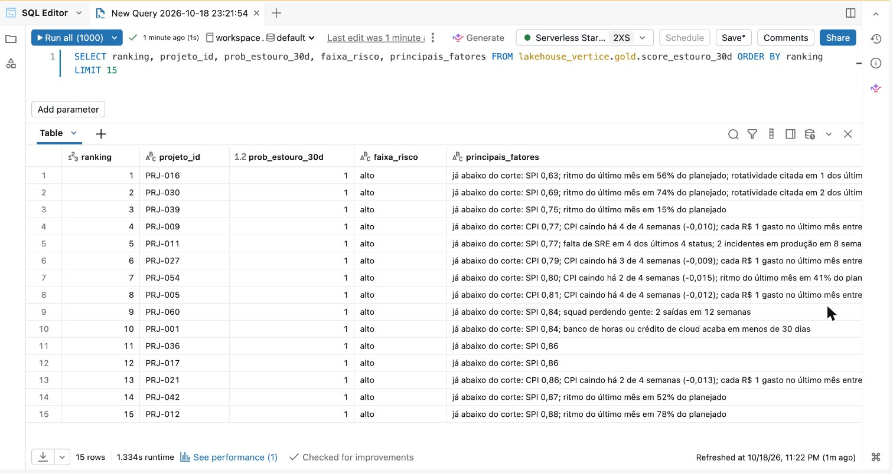 |
| **Agente Genie Curado sobre Metric Views** | **Auditoria de Contratos e Multas com IA** |
| 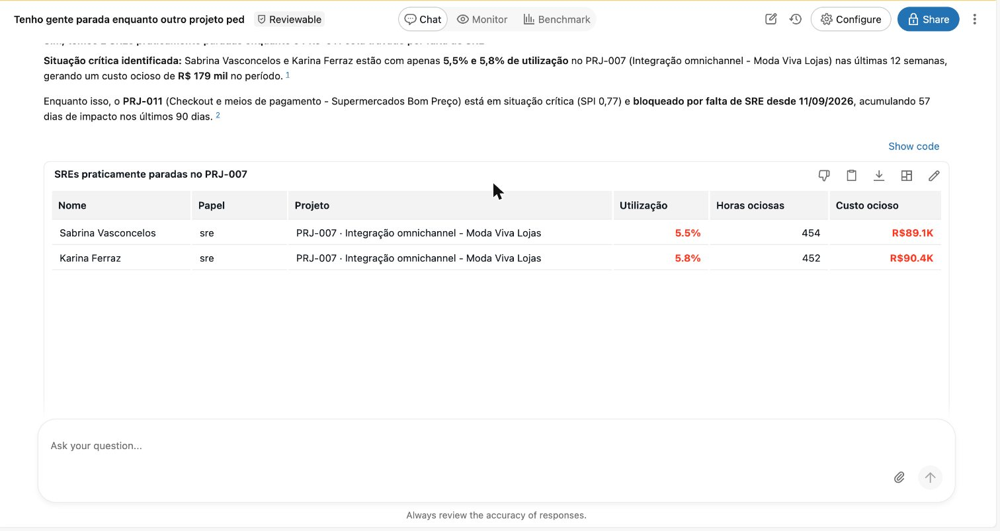 | 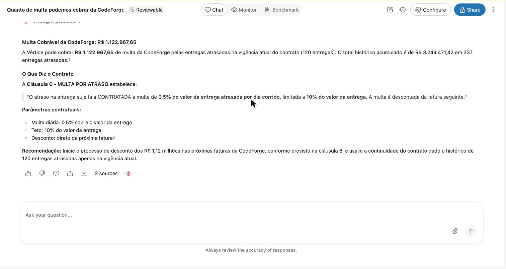 |

---

## 📁 Estrutura do Repositório

```text
vertice-control-tower/
├── databricks.yml                      # Configuração do Databricks Asset Bundle (IaC)
├── data_generator/                     # Gerador determinístico de dados corporativos multi-formato
│   ├── gerar_dataset.py                # Simula os 60 projetos semana a semana (seed 42)
│   ├── validar_padroes.py              # Suíte de testes dos padrões operacionais e financeiros
│   ├── xlsx_simples.py                 # Gerador/leitor nativo de arquivos .xlsx
│   └── pdf_simples.py                  # Gerador nativo de contratos e políticas em .pdf
├── sql/                                # Scripts SQL para execução interativa e ingestão Bronze
│   ├── 00_carregar_dados.py            # Notebook de provisionamento e carga inicial no Volume
│   ├── 00_setup_catalogo.sql           # Criação do catálogo lakehouse_vertice, schemas e volume
│   ├── 01_ingestao_bronze.sql          # Ingestão de CSV, Excel, JSON e XML via read_files()
│   ├── 02_analise_exploratoria_e_spi.sql # Qualidade de dados, tratamento de tipos e cálculo de SPI
│   ├── 03_analise_financeira_cpi_eac.sql # Cálculo de EV, CPI, EAC, estouro e projetos "melancia"
│   ├── 04_auditoria_delta_time_travel.sql # Auditoria de versões e recuperação com RESTORE TABLE
│   ├── 05_extracao_contratos_pdf_ia.sql # Leitura de contratos PDF com ai_parse_document()
│   └── 99_validacao_data_quality.sql   # Reconciliação automatizada de 18 indicadores de controle
├── pipelines/                          # Código-fonte do Pipeline Medalhão, IA e Machine Learning
│   ├── ingestao/                       # Notebooks de ingestão via API REST e S3 (boto3)
│   ├── conferencia/                    # Validação de pré-condições da camada Bronze
│   ├── silver/                         # Materialized Views com contratos de qualidade (EXPECT)
│   ├── gold/                           # Tabelas analíticas de portfólio, evolução semanal e equipe
│   ├── ia/                             # Extração estruturada de causas de atraso com ai_extract()
│   ├── metricas/                       # Definição da Metric View governada (mv_projetos)
│   ├── ml/                             # Features temporais, treino (MLflow) e inferência em lote
│   └── testes/                         # Testes automatizados de integridade da camada Gold
├── dashboards_and_genie/               # Artefatos de BI e Agentes Conversacionais
│   ├── dataset_projetos_em_andamento.sql
│   ├── dataset_custos_mensais.sql
│   ├── dashboard_executivo_bronze.lvdash.json
│   ├── dashboard_portfolio_gold.lvdash.json
│   ├── genie_space_bronze.json
│   └── genie_space_diretoria_gold.json
├── resources/                          # Definições de recursos do Databricks Asset Bundle
├── app/                                # Aplicação Full-Stack (React + Node.js + Lakebase Postgres)
└── scripts/                            # Utilitários de automação e execução via API de Statements
```

---

## 🚀 Como Executar o Projeto no Databricks

### Passo 1: Provisionar o Catálogo e Gerar os Dados Brutos
1. Importe este repositório no Databricks Workspace (**Workspace → Create → Git folder**).
2. Abra o notebook [`sql/00_carregar_dados.py`](sql/00_carregar_dados.py) e clique em **Run all**.
   - Ele criará o catálogo `lakehouse_vertice`, os schemas `bronze`, `silver`, `gold` e o volume `/Volumes/lakehouse_vertice/bronze/raw`, gerando todos os arquivos `.xlsx`, `.json`, `.xml`, `.csv` e `.pdf`.

### Passo 2: Ingestão e Análise na Camada Bronze (SQL Editor)
1. Execute [`sql/01_ingestao_bronze.sql`](sql/01_ingestao_bronze.sql) no **SQL Editor** para criar as 9 tabelas Delta da camada `bronze`.
2. Execute [`sql/02_analise_exploratoria_e_spi.sql`](sql/02_analise_exploratoria_e_spi.sql) e [`sql/03_analise_financeira_cpi_eac.sql`](sql/03_analise_financeira_cpi_eac.sql) para unificar os cronogramas e auditar o estouro previsto de **R$ 6,47 mi**.
3. Execute [`sql/99_validacao_data_quality.sql`](sql/99_validacao_data_quality.sql) para validar os 18 checks de qualidade (`status = 'ok'`).

### Passo 3: Deploy do Pipeline Completo via Databricks Asset Bundles (CLI)
Para implantar o pipeline declarativo (`silver` e `gold`), o modelo de Machine Learning, as Metric Views, o Dashboard e o Genie Space:

```bash
# Autenticação no workspace Databricks
databricks auth login --profile vertice

# Validação e deploy da infraestrutura como código
databricks bundle validate --profile vertice
databricks bundle deploy --profile vertice

# Execução do workflow ponta a ponta
databricks bundle run vertice_farol --profile vertice
```

### Passo 4: Automação Local em Python (Relatórios Executivos `.xlsx` e `.pdf`)
Para rodar localmente o pipeline analítico automatizado em Python que unifica as 3 ferramentas, calcula `SPI`, `CPI`, `EAC` e projetos "Melancia", e exporta relatórios prontos para a diretoria em `relatorios_automatizados/`:

```bash
python scripts/automacao_relatorio_executivo.py
```

---

## 🛠️ Stack Tecnológica

* **Plataforma:** Databricks Lakehouse (Unity Catalog, Serverless SQL Warehouse, Volumes)
* **Engenharia de Dados:** Spark SQL, PySpark, Delta Lake, Lakeflow Declarative Pipelines (`EXPECT`), `read_files()`
* **Inteligência Artificial & ML:** Databricks AI Functions (`ai_extract`, `ai_classify`, `ai_parse_document`), MLflow, Scikit-Learn (`HistGradientBoostingClassifier`), AI/BI Genie
* **Visualização & App:** Databricks AI/BI Dashboards (`.lvdash.json`), Metric Views, Databricks Apps (React, TypeScript, TailwindCSS), Lakebase (Serverless PostgreSQL)
* **DevOps & DataOps:** Databricks Asset Bundles (DABs), Git, Python 3.12
